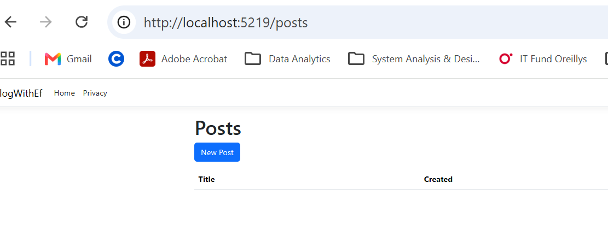
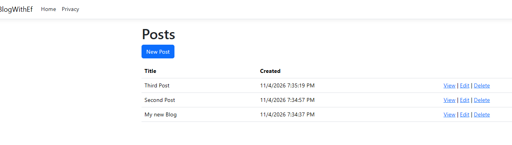
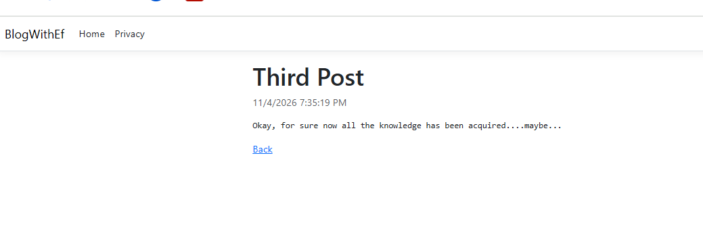
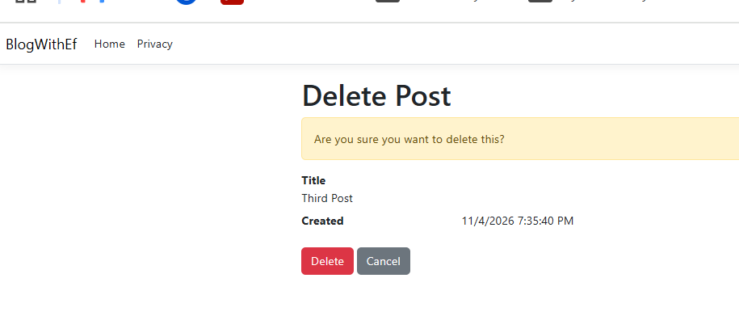
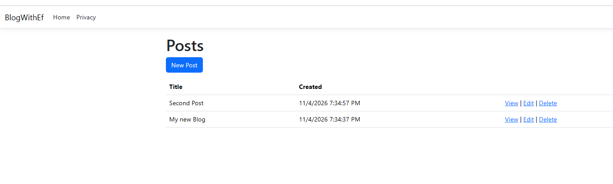

# BlogWithEf

## Project Description

This is an ASP.NET MVC application that uses Entity Framework Core with SQLite to store and manage blog posts.

## How to Run

1. Open the project in Visual Studio.
2. Run the application.
3. Navigate to the local host (/posts) Posts page.
4. Use **New Post** to create a new post.
5. Use **View** to open a post's details.
6. Use **Edit** to update a post.
7. Use **Delete** to remove a post (a confirmation page will be shown before deletion).

## Screenshots

### Blank /posts Page with no posts

### View all posts

### View Post Details

### Delete Post Confirmation Message

### Post Deleted (third post)

